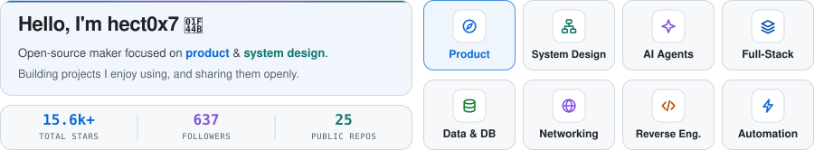
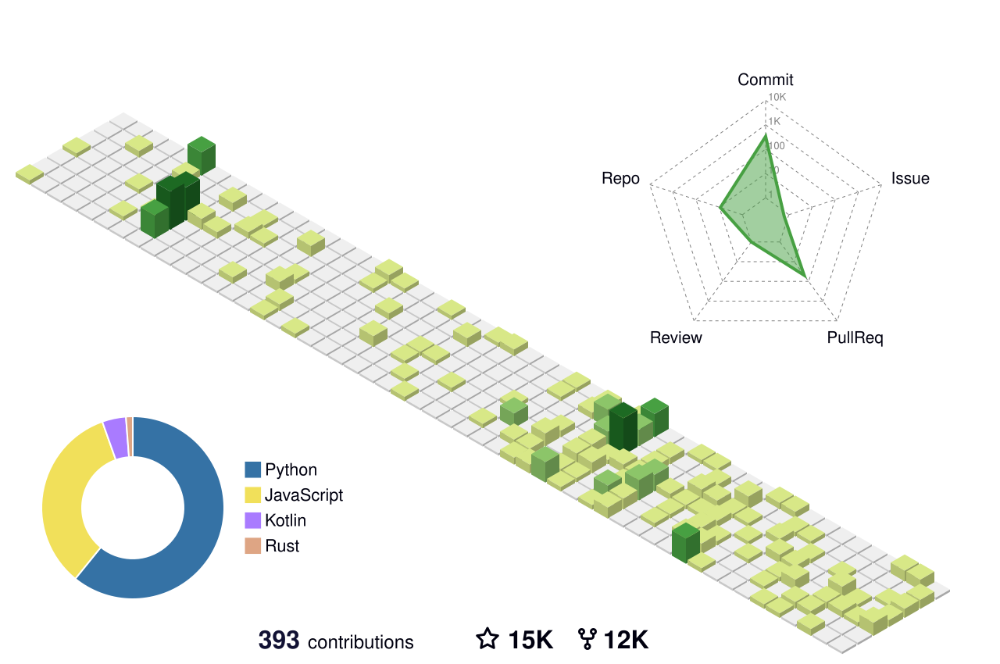
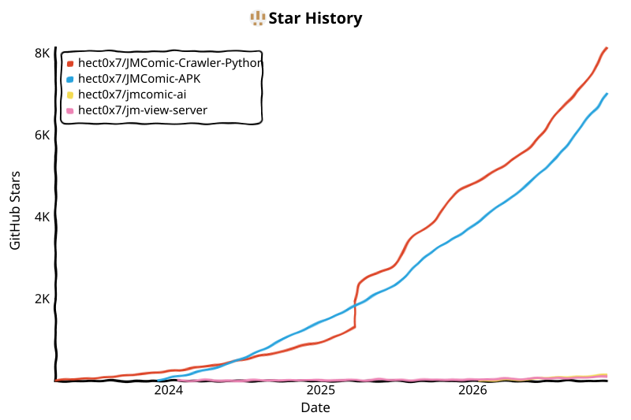

  <a href="https://github.com/hect0x7">
    <picture>
      <source media="(prefers-color-scheme: dark)" srcset="https://raw.githubusercontent.com/hect0x7/hect0x7/output/profile/profile-card-dark.svg">
      <source media="(prefers-color-scheme: light)" srcset="https://raw.githubusercontent.com/hect0x7/hect0x7/output/profile/profile-card-light.svg">
      
    </picture>
  </a>

 

  <picture>
    <source media="(prefers-color-scheme: dark)" srcset="https://raw.githubusercontent.com/hect0x7/hect0x7/output/github-contribution-grid-snake-dark.svg">
    <source media="(prefers-color-scheme: light)" srcset="https://raw.githubusercontent.com/hect0x7/hect0x7/output/github-contribution-grid-snake.svg">
    
  </picture>

 

  <picture>
    <source media="(prefers-color-scheme: dark)" srcset="https://raw.githubusercontent.com/hect0x7/hect0x7/output/profile/profile-3d-dark.svg">
    <source media="(prefers-color-scheme: light)" srcset="https://raw.githubusercontent.com/hect0x7/hect0x7/output/profile/profile-3d-light.svg">
    
  </picture>

 

  <a href="https://github.com/hect0x7/JMComic-Crawler-Python">
    <picture>
      <source media="(prefers-color-scheme: dark)" srcset="https://raw.githubusercontent.com/hect0x7/hect0x7/output/profile/star-history-dark.svg">
      <source media="(prefers-color-scheme: light)" srcset="https://raw.githubusercontent.com/hect0x7/hect0x7/output/profile/star-history.svg">
      
    </picture>
  </a>

